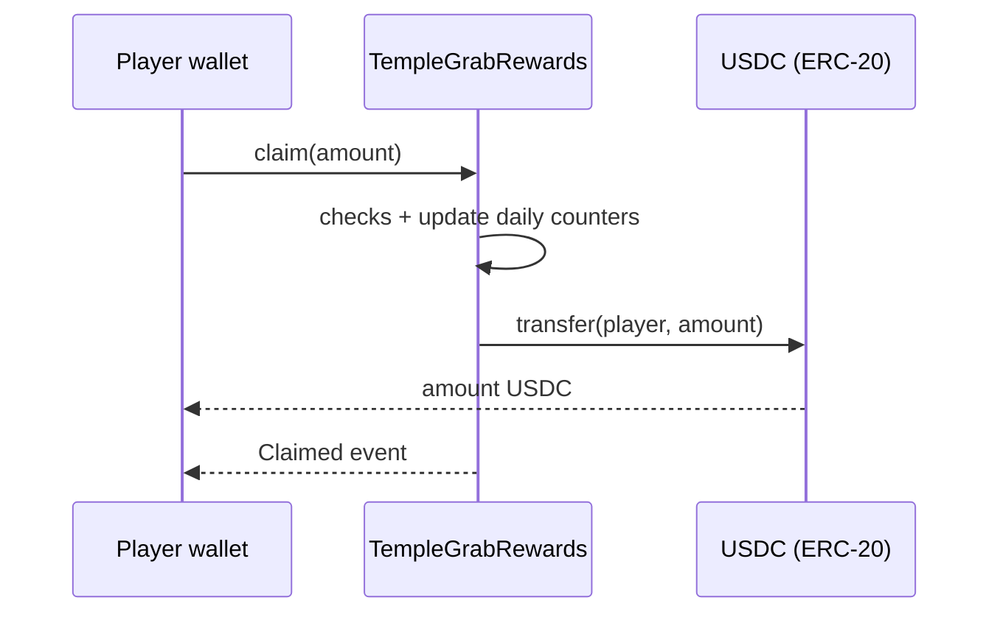

# TempleGrabRewards: Design Doc

## 1. Metadata

- Status: Draft (awaiting owner confirmation)
- Authors: Arc Studio, requested by the Temple Grab owner
- Target chain: Arc Testnet (testnet USDC only; no mainnet use)
- Language / toolchain: Solidity 0.8.28, Foundry, OpenZeppelin 5.x
- Milestone: testnet pilot. A fresh contract is deployed for any mainnet launch after independent review.
- Reviews: [ ] Design  [ ] Security  [ ] Ops

## 2. Action Items (living)

_Empty. Filled as review feedback is resolved._

## 3. Goals / Non-Goals

Goals
- A player connects a wallet and claims testnet USDC earned from collected coins (0.01 USDC per coin).
- The contract holds a pre-funded USDC reward pool and pays claimants directly from it.
- Strict, immutable limits: 1 USDC per claim, 5 USDC per wallet per UTC day.

Non-Goals
- Proving that a claimed amount was really earned in the game (see Trust Model: it cannot be proven in this version).
- Mainnet use, upgrades, withdrawal of pool funds, fees, or any token other than USDC.

## 4. Requirements

Functional
- F1. Any wallet can call `claim(amount)` and receive `amount` USDC to itself.
- F2. Anyone can fund the pool by transferring USDC to the contract address.
- F3. Views expose the pool balance and what a wallet can still claim today.

Security (testable assertions)
- S1. No call can send more than `maxPerClaim` to a wallet in one claim.
- S2. No wallet can receive more than `maxPerDay` in one UTC day through this contract.
- S3. The contract can never pay out more than `maxGlobalPerDay` in total in one UTC day.
- S4. USDC only ever leaves the contract through `claim`, and only to `msg.sender`. No withdraw, rescue or admin transfer exists.
- S5. Limits and the token address cannot change after deployment.
- S6. When paused, `claim` reverts.

## 5. Terminology & Actors

- Pool: the USDC balance held by the contract.
- UTC day: `block.timestamp / 1 days`.

| Actor | On/off-chain | Trust | Can do |
| --- | --- | --- | --- |
| Player wallet | Onchain | Untrusted | Call `claim`, send USDC to the pool |
| Funder | Onchain | Untrusted | Send USDC to the pool (cannot get it back) |
| Owner (testnet deployer) | Onchain | Semi-trusted | Pause and unpause claims. Nothing else. |
| Game frontend | Off-chain | Untrusted | Suggests an amount; the contract does not trust it |

## 6. Language / Runtime

Solidity 0.8.28 (checked arithmetic), Cancun EVM as configured in the project. Base contracts from OpenZeppelin: `Ownable2Step`, `Pausable`, `ReentrancyGuard`, `SafeERC20`.

## 7. Transaction & Execution Model

Each call is atomic. `claim` follows checks, then effects (update counters), then the single external interaction (USDC transfer), and is also `nonReentrant`.

## 8. Chain Standards & Interfaces

ERC-20 (USDC, 6 decimals in the ERC-20 view). On Arc the same pool is also the native gas asset; the contract only uses the ERC-20 view and never touches native value (no `receive`, no payable functions).

## 9. Architecture Overview



| Step | Who moves what | Invariant |
| --- | --- | --- |
| Fund | Anyone transfers USDC to the contract | Pool balance only increases |
| Claim | Contract sends `amount` USDC to the caller | amount <= per-claim cap; wallet and global day totals <= caps; amount <= pool balance |

Resting-state invariant: the contract holds exactly the unclaimed pool. There is no other accounting, so balance is the single source of truth.

Dependencies: Arc Testnet USDC (address from the project's chain registry). Assumes USDC is a standard ERC-20 that reverts on failure.

## 10. Contract Design

Roles

| Role | Holder | Permissions | Why |
| --- | --- | --- | --- |
| Owner | Testnet deployer, `Ownable2Step` (no renounce) | `pause`, `unpause` | Emergency stop only |

Storage

| Variable | Type | Notes |
| --- | --- | --- |
| `USDC` | `IERC20 immutable` | Token paid out |
| `MAX_PER_CLAIM` | `uint256 immutable` | 1_000_000 (1 USDC) |
| `MAX_PER_DAY` | `uint256 immutable` | 5_000_000 (5 USDC) |
| `MAX_GLOBAL_PER_DAY` | `uint256 immutable` | 200_000_000 (200 USDC), my proposal, see section 19 |
| `walletDay[addr]` | `struct {uint64 day; uint192 claimed}` | Day bucket and total claimed in it |
| `globalDay` | `struct {uint64 day; uint192 claimed}` | Same, for all wallets |

Writes

| Function | Caller | State changed | Events | Reverts |
| --- | --- | --- | --- | --- |
| `claim(uint256 amount)` | Anyone | wallet and global day counters; USDC leaves pool | `Claimed(player, amount, day)` | paused; amount == 0; amount > per-claim cap; wallet day total would exceed cap; global day total would exceed cap; pool balance < amount |
| `pause()` / `unpause()` | Owner | paused flag | OZ `Paused` / `Unpaused` | not owner |
| `transferOwnership` / `acceptOwnership` | Owner / pending owner | owner | OZ events | two-step; `renounceOwnership` is disabled |

Reads: `poolBalance()`, `claimableToday(address)` (min of per-claim cap, wallet remaining today, global remaining today, pool balance), `MAX_*` getters.

Pseudocode for `claim`
```
require(!paused)
require(amount > 0 && amount <= MAX_PER_CLAIM)
day = block.timestamp / 1 days
roll wallet bucket if walletDay.day != day (reset claimed = 0)
roll global bucket likewise
require(wallet.claimed + amount <= MAX_PER_DAY)
require(global.claimed + amount <= MAX_GLOBAL_PER_DAY)
require(USDC.balanceOf(this) >= amount)
wallet.claimed += amount; global.claimed += amount
USDC.safeTransfer(msg.sender, amount)
emit Claimed(msg.sender, amount, day)
```

Events: `Claimed(address indexed player, uint256 amount, uint256 day)` plus OZ ownership and pause events.

## 12. Deployment & Initialization

Constructor takes the USDC address, the three limits and the initial owner (the testnet deployer). Reverts on a zero token address, zero limits, or a per-claim cap above the daily cap. After deploy, the pool must be funded by sending testnet USDC to the contract (the in-app "Get test USDC" faucet works for this). Nothing else is needed.

## 13. Upgradeability

None. Fixed contract. Migration story: for the mainnet launch a new contract is deployed at a new address and the app is re-pointed. The old testnet pool is not recoverable (no withdraw), which is acceptable because it is testnet funds.

## 14. Key Management & Signing

No signatures and no off-chain authorization. The only privileged key is the owner (pause only).

## 15. Security Considerations

| Vulnerability | Applicable? | Mitigation |
| --- | --- | --- |
| Reentrancy | Yes (USDC transfer) | CEI ordering plus `nonReentrant` |
| Access control | Yes | One owner function pair (pause); `claim` pays only `msg.sender` |
| Integer overflow | Checked 0.8 | No `unchecked`; `uint192` counters are bounded by the caps |
| Unchecked external call | Yes | `SafeERC20` |
| Fee-on-transfer / rebasing | No | Only Arc USDC; payout is a plain transfer from own balance |
| Signature replay | N/A | No signatures |
| Front-running / MEV | Low | Claims are capped and pay the caller; ordering only affects who hits the global cap first |
| Oracle / flash loan | N/A | None used |
| Denial of service | Partly | No loops. Global daily cap can be exhausted by many wallets, which blocks others until the next UTC day (accepted) |
| Delegatecall / proxy | N/A | Not upgradeable |
| Timestamp dependence | Yes | Day bucket from `block.timestamp`; tolerance is seconds, not exploitable beyond the boundary effect below |
| Approval persistence | N/A | The contract never uses allowances |
| Centralization | Low | Owner can only pause, not move funds |
| Fake or inflated claims (Sybil, forged score) | Yes, the main risk | Cannot be prevented without verification. Bounded by per-claim, per-wallet-day and global-day caps |
| Day-boundary double claim | Yes | A wallet can take 5 USDC at 23:59 UTC and 5 USDC at 00:01. Accepted for simplicity, bounded at 2x |
| Stray tokens / funds sent by mistake | Yes | Locked forever (no rescue, by your choice) |

## 16. Trust Model & Threat Analysis

| Actor | Worst case if abused or compromised | Mitigation | Detection |
| --- | --- | --- | --- |
| Any player | Claims the maximum allowed without really earning it, from many wallets | Caps, plus global daily cap (S3) | `Claimed` events per day |
| Owner key | Pauses claims indefinitely (griefing). Cannot take funds. | Two-step ownership, pause-only power | `Paused` event |
| Frontend | Wrong amounts shown | Contract enforces caps regardless | n/a |

## 17. Emergency Response

`pause()` stops all claims. There is no rescue or withdraw. If the contract is found faulty, the plan is to pause it and deploy a fixed version; funds in the paused pool stay locked (testnet only).

## 18. Failure Scenarios

- Pool empty: `claim` reverts with an insufficient-pool error; no state changes. The app should show the pool balance and disable claiming.
- USDC transfer reverts (for example the caller is blocklisted): the whole claim reverts, so counters are not consumed.
- Reentrant call attempt from a contract wallet: blocked by `nonReentrant`, and counters are updated before the transfer anyway.

## 19. Priorities & Tradeoffs

| Decision | Tradeoff | Rationale / rejected alternative |
| --- | --- | --- |
| Open claims with caps | Scores are not verified | You chose it for the testnet. Rejected: server-signed claims (more infra to run). Revisit before mainnet. |
| Global daily cap (200 USDC) | Many players can exhaust it for the day | Added by me to bound the damage of Sybil wallets. Say so if you want it removed or changed. |
| UTC day bucket, not rolling 24h | Up to 2x across a boundary | Cheaper and simpler than a sliding window |
| No withdraw or rescue | Funds and stray tokens are locked | Your explicit choice |
| Owner can pause | Pause is useless if the owner key is unavailable | Kept as a cheap safety valve; shared testnet deployer is acceptable for testnet only |
| Immutable | Any change needs a new deploy | Safest; matches your plan |

## 20. Testing Strategy

Foundry unit tests: happy path, each revert path, day rollover (warp), exact-cap boundaries, pause and unpause, ownership two-step, events. Fuzz: random sequences of claims by random wallets never exceed per-wallet or global daily totals and never move more than the pool. Invariant: contract balance + total claimed == total funded. Static analysis with Slither. Fork verification on Arc Testnet before the live deploy.

## 21. Third-party libraries

| Library | Version | Already a dependency | Why |
| --- | --- | --- | --- |
| OpenZeppelin Contracts | project pin (5.x) | Yes | Audited `Ownable2Step`, `Pausable`, `ReentrancyGuard`, `SafeERC20` |

## 22. Monitoring

Watch `Claimed` per day against the global cap, and `Paused`. Check `poolBalance()` periodically so the app can warn when low.

## 23. App integration (summary)

After deploy the app shows a "Claim" action after each run: it connects the wallet, switches to Arc Testnet, sends `claim(amount)` for the unclaimed coin value (limited by `claimableToday`), shows pending and confirmed states with an explorer link, and refreshes the wallet USDC balance.
